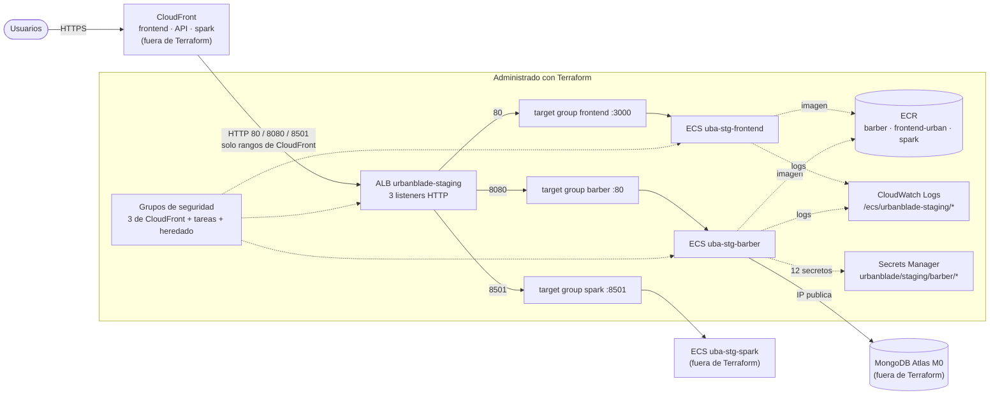

# Infraestructura de staging (T029)

Qué existe en AWS (cuenta `209479293733`, `us-east-1`), qué parte administra Terraform y cómo se conecta. Los IDs y ARN
concretos **no** están aquí: se obtienen con `terraform output` o con los `describe-*` de AWS.

## Diagrama

Línea continua = tráfico; punteada = uso o pertenencia. Los recursos del recuadro llevan `prevent_destroy`, salvo la
asociación de proveedores de capacidad del clúster ECS.

## Qué administra Terraform hoy

| Raíz | Recurso | Cantidad | Origen |
| --- | --- | --- | --- |
| `bootstrap/state` | Bucket de estado (bloqueo público, versionado, cifrado, solo TLS) | 5 recursos | base |
| `environments/staging` | ECR (barber, frontend-urban, spark) y grupos de logs | 3 + 3 importaciones | base |
| `environments/staging` | Grupos de seguridad | 5 importaciones | T024 |
| `environments/staging` | ALB, target groups y listeners | 1 + 3 + 3 importaciones | T024 |
| `environments/staging` | Clúster ECS, proveedores de capacidad y servicios (barber, frontend) | 1 + 1 + 2 importaciones | T026 |
| `environments/staging` | Secretos de barber (solo el contenedor, nunca el valor) | 12 importaciones | T026 |
| `environments/ephemeral` | Ambiente desechable por workspace `eph-*` | 5 recursos nuevos | T032 |

Staging suma **34 importaciones** (6 + 12 + 16). Lo que **no** está en Terraform todavía: distribuciones de CloudFront y
certificados, buckets S3 de recibos, subidas y respaldos, servicios `spark` y `ollama` (con su ECR, logs y secretos),
roles IAM y MongoDB Atlas. La VPC predeterminada se lee, no se administra.

## Variables (`environments/staging/variables.tf`)

| Variable | Tipo | Valor por defecto | Para qué sirve |
| --- | --- | --- | --- |
| `project_name` | string | `urbanblade` | Etiqueta `Project` de todos los recursos. |
| `environment` | string | `staging` | Etiqueta `Environment`. |
| `aws_region` | string | `us-east-1` | Región del proveedor. |
| `aws_account_id` | string | sin valor (obligatoria) | Cuenta esperada: el proveedor se niega a operar en otra. |

Se definen en `terraform.tfvars` (copiado de `terraform.tfvars.example`; el archivo real está en `.gitignore`).
Credenciales de AWS y de Atlas **siempre** por variables de entorno, nunca en `.tfvars`.

## Salidas (`terraform -chdir=environments/staging output`)

| Salida | Contenido |
| --- | --- |
| `aws_account_id`, `aws_region`, `environment` | Cuenta verificada, región y ambiente. |
| `vpc_id`, `subnet_ids` | VPC predeterminada y subredes (por zona). |
| `ecr_repository_urls`, `log_group_names` | URL de cada ECR y grupos de logs. |
| `security_group_ids` | Un grupo de CloudFront por puerto, el de las tareas y el heredado. |
| `alb_dns_name`, `alb_arn`, `alb_listeners`, `target_group_arns` | ALB, qué puerto reenvía a qué target group y sus ARN. |
| `ecs_cluster_name`, `ecs_service_names` | Clúster y servicios ECS. |
| `barber_secret_names` | Nombres (nunca valores) de los secretos de barber. |

Ninguna salida es sensible. Los valores de los secretos no existen en Terraform.

## Cómo regenerar la evidencia

1. `terraform -chdir=environments/staging validate` y `terraform fmt -check -recursive`.
2. Con credenciales de **solo lectura**: `terraform -chdir=environments/staging plan -out staging.tfplan`. El plan se
   aprueba solo si todas las importaciones dicen `will be imported` y no hay `-/+` ni `- destroy`.
3. `terraform -chdir=environments/staging output` y comparar con el diagrama.

## Hallazgos conocidos (se importan tal cual; ver `#checkov:skip` en el código)

- Los listeners del ALB son HTTP: CloudFront publica el HTTPS y habla HTTP con el origen.
- Un grupo de seguridad heredado acepta `0.0.0.0/0` en 80, 8080 y 8501, ya no está asociado al ALB y aún aparece en las
  reglas del grupo de las tareas.
- El ALB no tiene protección contra borrado, registros de acceso ni WAF.
