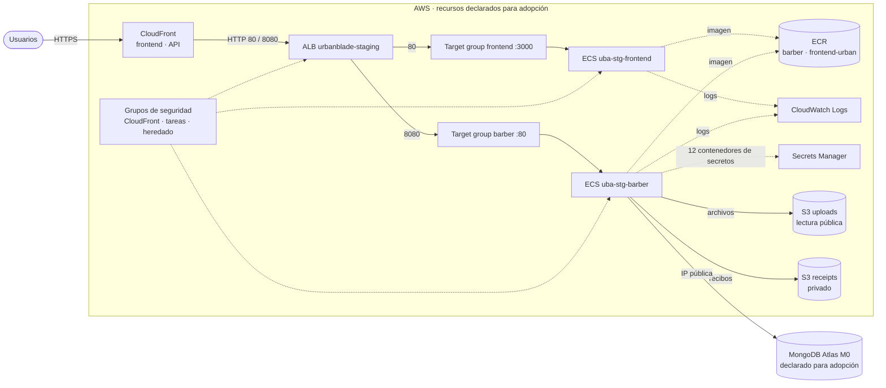

# Arquitectura e inventario de infraestructura

Inventario derivado del código de staging, revisado el 29-oct-2026. Describe la
arquitectura declarada y los recursos previstos para importación; no certifica
el estado remoto ni la configuración actual de AWS/Atlas. Algunos identificadores
están en los archivos Terraform: son metadatos de infraestructura, no credenciales.
No publicar estados, planes completos, contraseñas ni valores de secretos.

## Diagrama

Línea continua = tráfico; punteada = uso o pertenencia. Es una vista de las
relaciones declaradas, no una captura del entorno. No todos los recursos tienen
prevent_destroy: comprobar la guarda en cada declaración antes de intervenir.

## Inventario declarado

| Raíz | Recurso | Cantidad | Origen |
| --- | --- | --- | --- |
| `bootstrap/state` | Bucket de estado (bloqueo público, versionado, cifrado, solo TLS) | 5 recursos | base |
| `environments/staging` | ECR (barber, frontend-urban) y grupos de logs | 2 + 2 importaciones | base |
| `environments/staging` | Grupos de seguridad | 4 importaciones | T024 |
| `environments/staging` | ALB, target groups y listeners | 1 + 2 + 2 importaciones | T024 |
| `environments/staging` | Clúster ECS, proveedores de capacidad y servicios (barber, frontend) | 1 + 1 + 2 importaciones | T026 |
| `environments/staging` | Secretos de barber (solo el contenedor, nunca el valor) | 12 importaciones | T026 |
| `environments/staging` | Distribuciones de CloudFront (frontend, api) | 2 importaciones | T120 |
| `environments/staging` | Buckets S3 `uploads` y `receipts` (cifrado, bloqueo público, propiedad) y política pública de `uploads` | 2 + 6 + 1 importaciones | T120 |
| `environments/staging` | Clúster Atlas M0 y 4 usuarios de base de datos (sin contraseñas) | 1 + 4 importaciones declaradas | T118 |
| `environments/ephemeral` | Ambiente desechable por workspace `eph-*` | 4 por defecto, 5 con grupo opcional | T032 |

Staging suma **45 importaciones** (51 menos las 6 de spark: ECR, logs, target group, listener, grupo de seguridad y distribución; la incorporación al estado no se acredita aquí). Lo que **no** está en Terraform todavía: certificados ACM, la
lista de acceso de red de Atlas, el bucket S3 de respaldos, así como el servicio, ECR, logs y secretos
de `ollama`,
roles IAM y la contraseña de cada usuario de Atlas. La VPC predeterminada se lee, no se administra.

## Variables (`environments/staging/variables.tf`)

| Variable | Tipo | Valor por defecto | Para qué sirve |
| --- | --- | --- | --- |
| `project_name` | string | `urbanblade` | Etiqueta `Project` de todos los recursos. |
| `environment` | string | `staging` | Etiqueta `Environment`. |
| `aws_region` | string | `us-east-1` | Región del proveedor. |
| `aws_account_id` | string | sin valor (obligatoria) | Cuenta esperada: el proveedor se niega a operar en otra. |
| `atlas_project_id` | string | sin valor (obligatoria) | ID del proyecto; 24 caracteres hexadecimales. |
| `atlas_cluster_name` | string | sin valor (obligatoria) | Nombre real del clúster. |
| `atlas_region` | string | `US_EAST_1` | Región de Atlas; debe coincidir con el clúster. |

Se definen en `terraform.tfvars` (copiado de `terraform.tfvars.example`; el archivo real está en `.gitignore`).
Credenciales de AWS y de Atlas **siempre** por variables de entorno, nunca en `.tfvars`.

## Salidas (`terraform -chdir=environments/staging output`)

| Salida | Contenido |
| --- | --- |
| `aws_account_id`, `aws_region`, `environment` | Cuenta verificada, región y ambiente. |
| `vpc_id`, `subnet_ids` | VPC predeterminada y subredes (por zona). |
| `ecr_repository_urls`, `log_group_names` | URL de cada ECR y grupos de logs. |
| `security_group_ids` | Un grupo de CloudFront por puerto, el de las tareas y el heredado. |
| `alb_dns_name`, `alb_arn`, `alb_listeners`, `target_group_arns` | ALB, qué puerto reenvía a qué target group y sus ARN. |
| `ecs_cluster_name`, `ecs_service_names` | Clúster y servicios ECS. |
| `barber_secret_names` | Nombres (nunca valores) de los secretos de barber. |
| `atlas_cluster_name`, `atlas_database_usernames` | Clúster y usuarios de Atlas (nunca contraseñas ni cadenas de conexión). |
| `cloudfront_distributions`, `s3_bucket_names` | ID, dominio y alias de cada distribución; nombres de los buckets. |

Estas salidas exponen metadatos, no valores de secretos. Que un output no esté
marcado sensitive no convierte el estado completo en información publicable.
Terraform solo declara los contenedores de Secrets Manager, sin secret_version.

## Fronteras de gestión y decisiones

| Área | Comportamiento declarado | Implicación |
| --- | --- | --- |
| ECR | Etiquetas MUTABLE y escaneo al publicar. | Migrar a etiquetas SHA y coordinar rollback de aplicación antes de exigir inmutabilidad. |
| CloudWatch Logs | Retención de 90 días en staging. | La retención de otro entorno requiere decisión propia. |
| ECS | ignore_changes sobre task_definition y desired_count. | El pipeline de aplicaciones controla revisiones y escala; Terraform no corrige esos atributos. |
| Secrets Manager | Solo contenedores de doce secretos, sin secret_version. | Los valores se gestionan fuera de esta raíz. |
| CloudFront | Redirección HTTPS al usuario, TLSv1.2_2021 y origen HTTP al ALB; políticas CachingDisabled/AllViewer. | No implica cifrado extremo a extremo. Cambiar caché u origen necesita revisar sesiones y API. |
| S3 | uploads con lectura pública GetObject; receipts privado. | Mantener separación de contenido público y privado; no modificar políticas sin revisar consumidores. |
| Atlas | Configuración M0 y cuatro usuarios; ignore_changes sobre password. | No gestiona contraseñas, acceso de red ni una estrategia de recuperación de datos. |
| Etiquetas | Project, Environment y ManagedBy por proveedor. | La adopción puede proponer cambios en sitio y necesita permisos de etiquetado. |

La VPC, subredes y prefix list de CloudFront se leen mediante data sources. El
certificado ACM se referencia, no se crea aquí. Las protecciones de ciclo de vida
no sustituyen controles nativos, backups o permisos y no impiden toda actualización.

Los fundamentos y consecuencias están en [DECISIONES_ARQUITECTURA.md](DECISIONES_ARQUITECTURA.md).
El procedimiento para revisar importaciones y operar el estado está en
[OPERACION_TERRAFORM.md](OPERACION_TERRAFORM.md). Los niveles de evidencia y resultados
previos están en [EVIDENCIAS.md](EVIDENCIAS.md).

## Hallazgos del código (pendientes de contraste con el entorno)

- Los listeners del ALB son HTTP: CloudFront publica el HTTPS y habla HTTP con el origen.
- Un grupo de seguridad heredado acepta `0.0.0.0/0` en 80, 8080 y 8501, el código no lo asocia al ALB, pero aún aparece en las
  reglas del grupo de las tareas. Su uso real necesita verificación autorizada.
- El ALB no tiene protección contra borrado, registros de acceso ni WAF.

El [registro de excepciones de Checkov](EXCEPCIONES_CHECKOV.md) detalla alcance,
riesgos y criterios de revisión. Los motivos inline no acreditan aceptación del riesgo.

[Índice de documentación](README.md) · [Pruebas sin nube](PRUEBAS.md).
